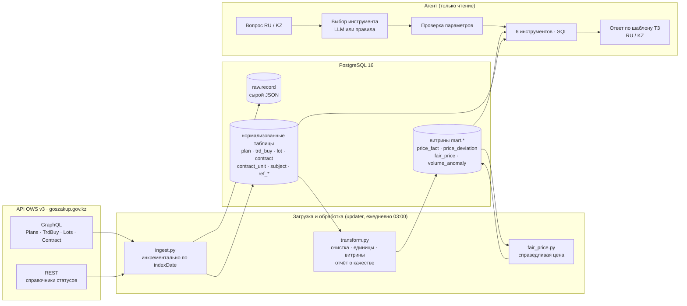
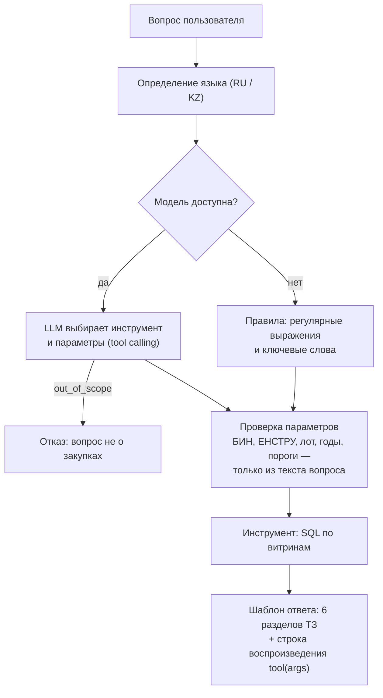

# 1. Архитектура

## 1.1. Общая схема

Система состоит из четырех слоев: загрузка из API, хранилище, аналитический слой и агент. Каждый слой получает данные только от предыдущего, поэтому любую цифру в ответе можно проследить до исходной записи API.

| Компонент | Файл | Запуск |
|---|---|---|
| Загрузка из API | `src/ingest.py` | сервис `updater` |
| Витрины и контроль качества | `src/transform.py`, `sql/marts.sql` | сервис `updater` |
| Справедливая цена | `src/fair_price.py` | сервис `updater` |
| Расписание | `src/scheduler.py` | сервис `updater` |
| Агент | `src/agent/`, `src/ask.py` | `docker compose run agent` |
| Оценка точности | `src/evaluate.py` | вручную |

## 1.2. Изучение API и выбор сущностей

Перед проектированием API был исследован разовыми скриптами (`src/explore.py`, `src/explore_details.py`, `src/probe_*.py`). Скрипты выясняли объёмы записей по каждому БИН, способ пагинации, поведение фильтра `indexDate`, вложенные объекты, состав REST-справочников и реальные значения статусов. Результаты разведки лежат в `data/raw/` (в репозиторий не входят, так как содержат реальные ответы API).

Выбранные сущности и причины выбора:

| Сущность OWS v3 | Требование ТЗ | Зачем нужна |
|---|---|---|
| `Plans` (с вложенными `RefUnits`, `RefEnstru`, `PlansKato`) | план, справочники | плановое количество по годам для анализа роста объёмов; место поставки (КАТО) для сравнения цен по городу; единицы измерения и ЕНСТРУ приходят вложенными |
| `TrdBuy` | объявления, статусы | номер объявления, способ закупки, статус; ссылка на объявление в ответе |
| `Lots` (с вложенным `TrdBuy`) | лоты | номер лота: по нему пользователь спрашивает о справедливости цены |
| `Contract` (с вложенными `ContractUnits`, `Supplier`, `Customer`, `Plans`) | договоры, заказчики, поставщики | фактические цены и количества по позициям — основа всей ценовой аналитики; версии договоров и их статусы |
| REST `refs/ref_contract_status`, `ref_lots_status`, `ref_buy_status`, `ref_trade_methods`, `ref_subject_type` | статусы, вид предмета (товар / работа / услуга) | человеческие названия статусов на RU и KZ |
| `ref_kato` (через `PlansKato`) | справочники | названия городов и областей, иерархия для перехода «город → область → страна» |

Связи между сущностями: позиция договора (`ContractUnits`) ссылается на лот (`lotId`) и пункт плана (`plnPointId`); лот — на объявление (`trdBuyId`); договор — на заказчика, поставщика и объявление.

## 1.3. Загрузка и инкрементальное обновление

- **Охват:** 27 БИН из `bins.py`, период 2024–2026. Для планов фильтр по году плана, для объявлений по дате публикации, для договоров по дате подписания. Лоты фильтруются по дате публикации их объявления.
- **Пагинация:** курсором `after: lastId`, по 200 записей; при ответах 429/5xx — повтор с паузой.
- **Сырой слой:** каждая запись сохраняется целиком в `raw.record` (JSONB). Это позволяет пересобрать нормализованные таблицы без повторного обращения к API и разбирать спорные случаи.
- **Инкрементальность:** для каждой пары «сущность + БИН» в `etl_state` хранится максимальный `indexDate` прошлой загрузки. Следующий запуск запрашивает только записи с `indexDate` не раньше этой отметки минус один день. Запись вставляется через `INSERT … ON CONFLICT DO UPDATE`, поэтому повторная загрузка той же записи безопасна.
- **Расписание:** `scheduler.py` запускает цепочку `ingest → transform → fair_price` при старте контейнера и каждый день в 03:00 (Asia/Astana).
- **Фактические показатели:** повторное обновление занимает около 10 минут. В базе 36 922 договора (30 616 актуальных версий) и 78 327 позиций с ценами.

## 1.4. Хранилище и аналитический слой

Три уровня в одной базе PostgreSQL:

1. **`raw`** — сырые ответы API.
2. **Нормализованные таблицы** — по одной на сущность, плюс справочники.
3. **Витрины `mart.*`** — подготовленные для агента данные: актуальная версия каждого договора, позиции с ценой за базовую единицу и городом поставки, эталонные цены по группам, отклонения, справедливая цена, рост объёмов.

Витрины пересобираются полностью после каждой загрузки (`sql/marts.sql`). Агенту не нужно знать о версиях договоров, единицах измерения и очистке названий: всё это уже сделано в витринах. После пересборки `transform.py` печатает отчёт о качестве данных (раздел 1.7).

## 1.5. Логика агента

Принципы:

- **LLM не считает.** Модель только выбирает один из шести инструментов и заполняет параметры. Все суммы, медианы, отклонения и количества считает SQL или Python.
- **LLM не пишет текст ответа.** Ответ собирается из шаблонов `src/agent/texts.py` на языке вопроса. Числа в тексте подставляются из результата инструмента, поэтому модель не может их исказить.
- **Проверка параметров.** Идентификаторы (БИН, код ЕНСТРУ, номер лота или договора), годы и пороги принимаются, только если они есть в вопросе.
- **Запасной режим.** Без ключа или при недоступности модели вопросы разбирают правила. Типовые вопросы они понимают полностью, свободные формулировки хуже
- **Отказы.** Вопросы не о закупках модель направляет в `out_of_scope`, правила — через фильтр тематических слов. Если ни одно слово запроса не встречается в названиях позиций, агент сообщает об этом, а не возвращает пустой ответ.
- **Воспроизводимость.** Каждый ответ заканчивается строкой вида `spend_summary(customer_bin="990740002243", year_from=2025, year_to=2025, group_by="supplier")`. 

| Инструмент | Тип вопроса ТЗ | Основная витрина |
|---|---|---|
| `search_contracts` | поиск | `price_fact`, `contract_current` |
| `spend_summary` | аналитика | `contract_current`, `price_fact` |
| `compare_prices` | сравнение | `price_fact` |
| `price_anomalies` | выявление аномалий | `price_deviation`, `fair_price` |
| `fair_price_check` | справедливость цены | `fair_price` |
| `volume_anomalies` | справедливость количества | `volume_anomaly` |

**Подключение моделей.** Поддерживаются три способа: Anthropic Messages API, OpenAI-совместимый `/chat/completions` (Gemini, DeepSeek, OpenRouter, локальные Ollama и vLLM) и OpenAI Responses API для рассуждающих моделей. Провайдер переключается в `.env`, код не меняется. Проверено на `gpt-6.1-sol`.

## 1.6. Безопасность и защита токенов

- Токен OWS и ключи моделей хранятся только в `.env`. Файл исключён из Git (`.gitignore`) и из Docker-образа (`.dockerignore`) и передаётся в контейнеры как переменные окружения.
- В языковую модель отправляется только текст вопроса и описание инструментов. Данные из базы в модель не передаются.
- Агент подключается к базе в режиме только для чтения (`default_transaction_read_only=on`).
- PostgreSQL слушает только `127.0.0.1`.
- Приложение в контейнере работает от непривилегированного пользователя.

## 1.7. Контроль качества данных

После каждой пересборки витрин `transform.py` выводит отчёт о качестве данных в лог сервиса `updater`. Последний отчёт:

| Проверка | Значение |
|---|---|
| договоров в базе / актуальных версий | 36 922 / 30 616 |
| договоров без позиций | 0 |
| позиций с ценами | 78 327 |
| с некорректной ценой | 116 |
| с нулевым или отрицательным количеством | 1 |
| с несходящейся суммой (цена × количество ≠ сумма) | 484 |
| без кода ЕНСТРУ / без единицы измерения | 0 / 0 |
| пригодных для эталона цен | 70 598 (90%) |
| с городом из плана поставки | 30 519 (39%) |
| групп «ЕНСТРУ + единица» / из них с 5+ позициями | 11 703 / 3 276 |
| последнее обновление из API | 2026-10-15 21:23 UTC (02:23 по Астане) |

Позиции, не прошедшие проверки, остаются в базе и видны в поиске, но не участвуют в расчёте эталонных и справедливых цен.

## 1.8. Развёртывание

Система разворачивается одной командой `docker compose up -d --build` и не требует доступа в интернет, кроме API OWS (и API модели, если выбран облачный провайдер).

| Сервис | Образ | Назначение |
|---|---|---|
| `db` | `postgres:16` | хранилище; данные в томе `pgdata`, схема создаётся при первом старте |
| `updater` | `zakup-agent` | ежедневное обновление; перезапускается автоматически |
| `agent` | `zakup-agent` | запускается по запросу для каждого вопроса |

Вся конфигурация передаётся через переменные окружения, состояние хранится только в PostgreSQL, а сервисы `updater` и `agent` не хранят данных у себя.
