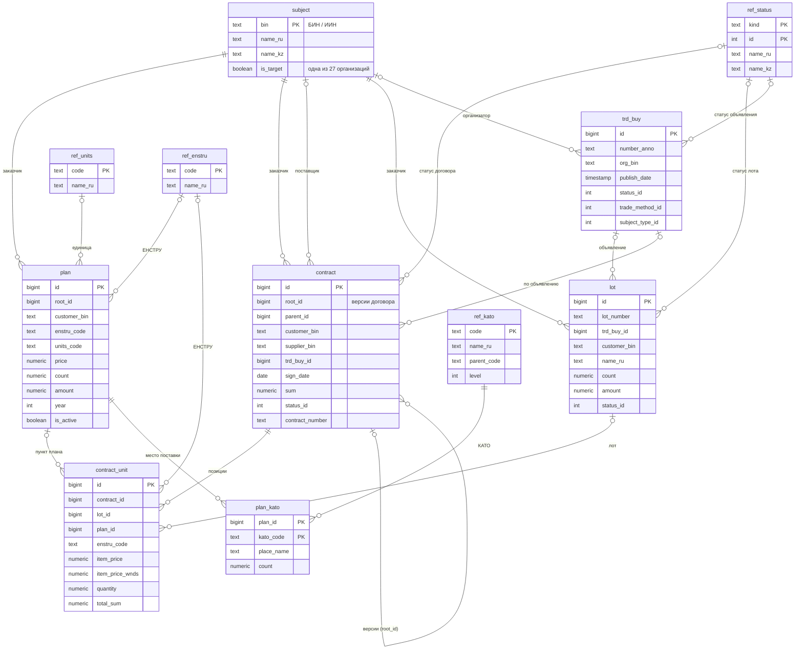
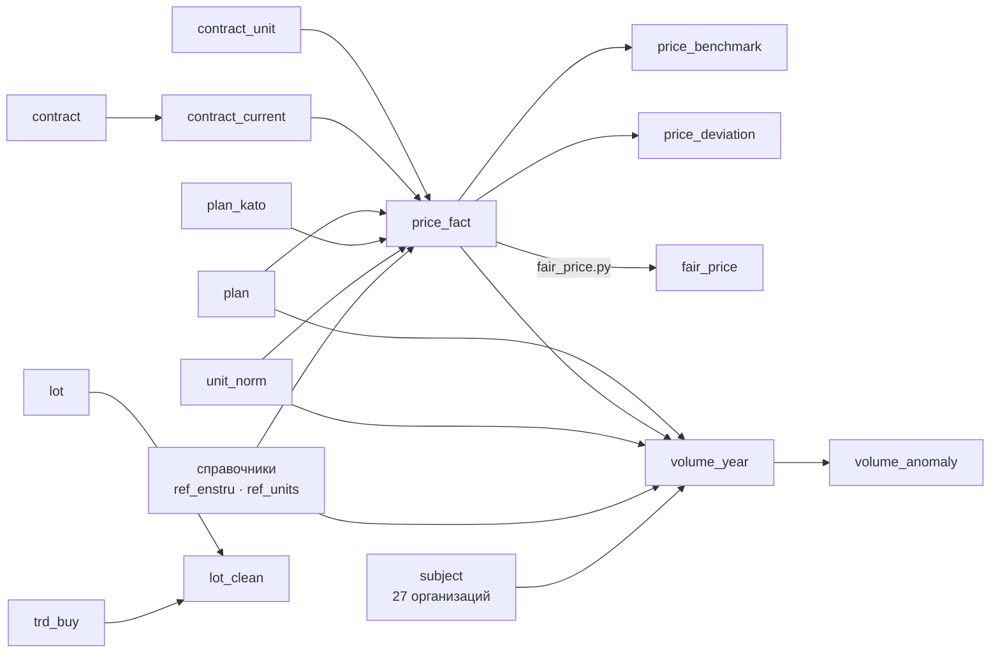

# 2. Схема хранения данных

База — PostgreSQL 16. Данные хранятся на трёх уровнях, у каждого своя задача:

| Уровень | Где | Задача | Кто пишет |
|---|---|---|---|
| Сырой | схема `raw` | точная копия ответов API для аудита и пересборки | `ingest.py` |
| Нормализованный | схема `public` | одна таблица на сущность OWS v3, справочники, состояние загрузки | `ingest.py` |
| Аналитический | схема `mart` | витрины, готовые для агента: цены за единицу, версии договоров, отклонения, справедливая цена, рост объёмов | `transform.py`, `fair_price.py` |

Описание таблиц — `sql/schema.sql`, витрин — `sql/marts.sql`.

## 2.1. Сырой слой

| Таблица | Ключ | Содержимое |
|---|---|---|
| `raw.record` | `(entity, id)` | ответ API по каждой записи целиком в `jsonb` и время загрузки |
| `etl_state` | `(entity, bin)` | последний загруженный `indexDate`, число загруженных строк и время обновления для каждой пары «сущность + БИН»; на этом построена инкрементальная загрузка |

Сырой слой нужен, чтобы пересобрать нормализованные таблицы без повторного обращения к API, когда меняется схема.

## 2.2. Нормализованный слой

| Таблица | Сущность OWS v3 | Ключевые поля и особенности |
|---|---|---|
| `subject` | заказчики и поставщики (из вложенных объектов) | название на RU и KZ; `is_target` отмечает 27 организаций |
| `plan` | `Plans` | плановое количество, цена, сумма, год; основа анализа роста объёмов |
| `plan_kato` | `PlansKato` | место поставки по КАТО; основа сравнения цен в том же городе |
| `trd_buy` | `TrdBuy` | объявление: номер, дата публикации, статус, способ закупки, вид предмета |
| `lot` | `Lots` | номер лота, по которому пользователь спрашивает о справедливости цены; ссылки на пункты плана, ЕНСТРУ, КАТО |
| `contract` | `Contract` | договор с версиями (`root_id`, `parent_id`), датой, суммой, статусом |
| `contract_unit` | `ContractUnits` | позиция договора: цена за единицу (с НДС и без), количество, сумма; ссылки на лот и пункт плана — главная таблица для ценовой аналитики |
| `ref_units`, `ref_enstru`, `ref_kato` | вложенные справочники | единицы измерения, классификатор ЕНСТРУ, территории КАТО |
| `ref_status` | REST `refs/*` | пять справочников: статусы договоров, лотов, объявлений, способы закупки, виды предмета (товар / работа / услуга); названия на RU и KZ |

**Индексы** созданы под реальные запросы агента: по БИН и дате (`contract`, `plan`, `trd_buy`), по коду ЕНСТРУ, номеру лота, номеру договора, поставщику, ссылке позиции на договор и пункт плана.

## 2.3. Аналитический слой (витрины)

| Витрина | Тип | Что содержит | Используется |
|---|---|---|---|
| `mart.unit_norm` | таблица | 44 кода единиц измерения → базовая единица и множитель (например, 163 «грамм» → кг × 0,001) | `price_fact`, `volume_year` |
| `mart.contract_current` | представление | только последняя версия каждого договора (`DISTINCT ON root_id`), без удалённых; статус сведён в группы `active`, `changed`, `terminated`, `transferred` | суммы расходов, поиск |
| `mart.price_fact` | материализованное представление | позиция договора с ценой и количеством **в базовой единице**, городом поставки (из плана, иначе по адресу заказчика), флагами проверок `price_ok`, `qty_ok`, `sum_ok` и итоговым `is_benchmark` | все ценовые инструменты |
| `mart.price_benchmark` | материализованное представление | по группе «ЕНСТРУ + базовая единица»: N, средневзвешенная цена, медиана, Q1, Q3, min, max | сравнение цен |
| `mart.price_deviation` | представление | отклонение цены позиции от средневзвешенной по **остальным** позициям группы (без самой позиции) | аномалии цен |
| `mart.fair_price` | таблица | справедливая цена позиции, Q1, Q3, число аналогов, уровень сравнения (город / область / страна), отклонение, переплата, вердикт, уверенность | справедливость цены, подтверждение аномалий |
| `mart.volume_year` | материализованное представление | плановое и законтрактованное количество по «организация + ЕНСТРУ + единица + год» | рост объёмов |
| `mart.volume_anomaly` | представление | рост к среднему за прошлые годы, робастный z-показатель, вердикт | рост объёмов |
| `mart.lot_clean` | представление | название лота после очистки (регистр, кавычки, лишние пробелы, неразрывные пробелы, «ё») и год объявления | поиск по лотам |

### Как позиция попадает в эталон цен

Позиция участвует в расчёте эталонных и справедливых цен (`is_benchmark = true`), только если выполнены все условия:

1. цена больше нуля и не равна 1;
2. количество больше нуля;
3. цена × количество сходится с суммой позиции (допуск 0,5% или 1 тенге);
4. известны код ЕНСТРУ и базовая единица;
5. договор действует или передан, а не расторгнут и не заменён новой версией.

Остальные позиции не удаляются: они видны в поиске и учитываются в отчёте о качестве. По последнему отчёту в эталон попадают 70 598 из 78 327 позиций (90%).

### Нормализация единиц измерения

Одинаковый товар закупают в разных единицах. Цена приводится к базовой единице делением на множитель, количество — умножением на него, поэтому цены разных закупок становятся сравнимыми. Единицы, которых нет в таблице `unit_norm`, остаются как есть (по названию из справочника) и сравниваются только между собой.

### Определение города поставки

1. Если у пункта плана есть место поставки (`plan_kato`), город берётся из его кода КАТО; при нескольких местах берётся место с наибольшим количеством.
2. Иначе берётся город, куда заказчик чаще всего поставляет по своим планам.

Код КАТО сводится к уровню города: для Астаны, Алматы и Шымкента — первые 2 знака, для остальных — первые 4. Город из плана известен для 39% позиций, для остальных он определён по заказчику.

## 2.4. Объём данных

| Показатель | Значение |
|---|---|
| Организаций | 27 |
| Период | 2024–2026 |
| Договоров (все версии) | 36 922 |
| Актуальных версий договоров | 30 616 |
| Позиций договоров с ценой | 78 327 |
| Из них в эталоне цен | 70 598 |
| Групп «ЕНСТРУ + единица» | 11 703 (из них с 5+ позициями — 3 276) |
| Позиций с оценкой справедливой цены | 33 309 (47% эталонных) |
